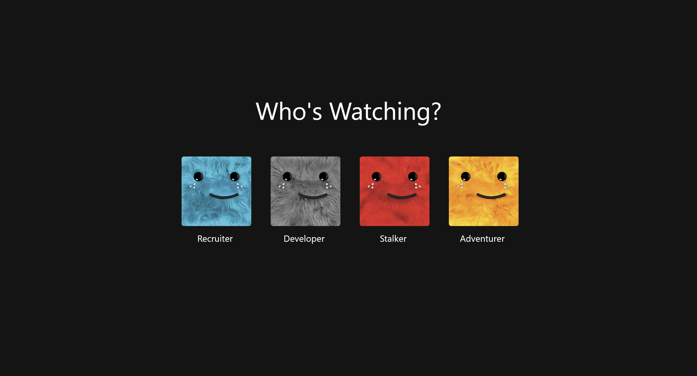

# 🎬 Yasindu Malith De Silva – Netflix-Inspired Portfolio


[Live Site](#-live-site) · [Features](#-features) · [Tech Stack](#️-tech-stack) · [Getting Started](#-getting-started) · [Deployment](#-deployment)

The personal portfolio of **Yasindu Malith De Silva** (also known as **Malith De Silva** and **Yasindu De Silva**), Site Reliability Engineer Intern at WSO2 and Computer Science student at the University of Westminster.

A dynamic, fully responsive portfolio designed to mimic the Netflix UI. It's built with React and TypeScript, and all content is managed through the DatoCMS headless CMS, so it can be updated without touching the code.



## 🌐 Live Site

**[malith.is-a.dev](https://malith.is-a.dev)**

## ✨ Features

- **🎬 Netflix-Inspired UI**: A familiar and engaging user interface.
- **✍️ Fully Dynamic Content**: All text, images, projects, skills, and personal information are fetched from DatoCMS.
- **🎭 Multiple User Profiles**: Tailor the content for different audiences (e.g., 'Recruiter', 'Developer') with unique "Top Picks" sections.
- **📱 Responsive Design**: A seamless experience on desktop, tablet, and mobile devices.
- **🧩 Component-Based Pages**: Separate, dynamic pages for Skills, Projects, Work Experience, and more.
- **✨ Engaging Animations**: Subtle animations to enhance the user experience.
- **🔎 Search & AI Friendly**: Every page is pre-rendered at build time with its own title, description and canonical URL, so search engines and AI crawlers can read the content without running JavaScript. Also generates `sitemap.xml` and `llms.txt`.
- **📣 Automatic IndexNow**: Each production deploy submits the site's URLs to Bing and other IndexNow search engines.

## 🛠️ Tech Stack

- **⚛️ React**: A JavaScript library for building user interfaces.
- **🔷 TypeScript**: A typed superset of JavaScript.
- **⚡ Vite**: Dev server and production build.
- **🗃️ DatoCMS**: Headless CMS for all content management.
- **🧭 React Router**: For declarative routing in the application.
- **🛰️ GraphQL**: Query language for the CMS API, used via `graphql-request`.
- **🧪 Vitest + Testing Library**: Unit tests.
- **🎨 CSS**: Custom styling to achieve the Netflix look and feel.
- **☁️ Netlify**: Hosting, with a build plugin for IndexNow.

## 🚀 Getting Started

To get a local copy up and running, follow these steps.

### Prerequisites

- Node.js 22 (see `.nvmrc`)
- npm

### 1. Set up DatoCMS

This project requires a DatoCMS backend to function.

1.  **Create a DatoCMS Account**: If you don't have one, sign up for a free account at datocms.com.
2.  **Create a New Project**: Start a new project from scratch.
3.  **Get Your API Token**: In your project, go to `Settings` > `API Tokens`. Find the **Read-only API token** and copy it. You will need this for your `.env` file.
4.  **Create Models (Schema)**: Go to `Settings` > `Models` and create the following models. The API identifiers are important because the GraphQL queries in `src/queries/` use them.
    - **Profile Banner** (`profilebanner`, single instance): `headline` (String), `profile_summary` (Structured Text), `background_image` (Single Asset), `resume_link` (Single Asset), `linkedin_link` (String).
    - **Timeline** (`timeline`): `name` (String), `timeline_type` (String: `Work` or `Education`), `title` (String), `date_range` (String, e.g. `2025-2026` or `2026-Present`), `tech_stack` (Text), `summary_points` (Text).
    - **Skill** (`skill`): `name` (String), `category` (String), `description` (Structured Text), `icon` (String; must match a key in the icon map in `src/pages/Skills.tsx`, e.g. `aws`, `kubernetes`).
    - **Project** (`project`): `title` (String), `description` (Structured Text), `tech_used` (String), `image` (Single Asset), `github_link` (String).
    - **Certification** (`certification`): `title` (String), `issuer` (String), `issued_date` (String), `link` (String), `icon_name` (String).
    - **Contact Me** (`contactme`, single instance): `name`, `title`, `summary` (Structured Text), `profile_picture` (Single Asset), `company_university`, `linkedin_link`, `email`, `phone_number`, `github_link`.
    - **Image** (`image`): `assets` (Asset Gallery). This is used for the homepage card images.
5.  **Populate Content**: Go to the `Content` tab and add your data to the models you just created.
6.  **Image Titles**: For the `Image` model, upload the images you want for the homepage cards. **Give each image a `Title` in the media library that exactly matches the card's title** (e.g., "Skills", "Projects", "Experience"). This is how the code maps images to cards.

### 2. Install Locally

1.  **Clone the repository**:
    ```sh
    git clone https://github.com/Yasindu007/Yasindu007-netflix_portfolio.git
    cd Yasindu007-netflix_portfolio
    ```
2.  **Install dependencies**:
    ```sh
    npm install
    ```
3.  **Add your API token** to a `.env` file in the project root:
    ```env
    REACT_APP_DATO_CMS_API_TOKEN=YOUR_READ_ONLY_API_TOKEN
    ```
4.  **Run the development server**:
    ```sh
    npm start
    ```
    The application should now be running on `http://localhost:3000`.

### Useful Scripts

```bash
npm start         # Run dev server
npm run build     # Type-check, production build, then pre-render pages
npm run preview   # Serve the production build locally
npm test          # Run tests
npm run lint      # Lint TypeScript/TSX
npm run format    # Prettier format
```

## 🎨 Customization

Almost all customization happens in DatoCMS, not in the code.

- **✍️ Changing Text**: Edit the entries in your DatoCMS `Content` section for models like `Profile Banner` or `Contact Me`.
- **🖼️ Changing Images**:
  - For the main banner or profile picture, replace the image in the corresponding DatoCMS entry.
  - For the homepage "Top Picks" cards, go to your `Image` model in DatoCMS, and upload/change the images in the `assets` gallery. Remember to set the `Title` of each asset correctly.
- **🎭 Adding/Removing Profiles**: To change the profile types (e.g., add a 'designer' profile), edit the configuration objects in:
  - `src/profilePage/TopPicksRow.tsx`
  - `src/profilePage/ContinueWatching.tsx`
  - `src/browse/browse.tsx`
- **🔎 SEO details**: Site-wide metadata and structured data live in `index.html`. Per-page titles, descriptions and the pre-rendered text are generated by `scripts/prerender.mjs`.

## 🚀 Deployment

The live site is deployed on **Netlify**.

1.  In Netlify, click "Add new site" → "Import an existing project" and select this repository.
2.  Confirm the build settings:
    - **Build command**: `npm run build`
    - **Publish directory**: `build`
3.  Under "Environment variables", add:
    - **Key**: `REACT_APP_DATO_CMS_API_TOKEN`
    - **Value**: _Your DatoCMS read-only API token_
4.  Click "Deploy site".

The `netlify.toml` file registers a local build plugin (`netlify/plugins/indexnow`) that submits the sitemap's URLs to IndexNow after each production deploy.

**Rebuild on content changes:** create a Netlify **build hook**, then add a DatoCMS **webhook** that calls it when records are published, unpublished or deleted. The pre-rendered pages, `sitemap.xml` and `llms.txt` then stay in sync with the CMS.

## 🤝 Contributing

Issues and suggestions are welcome.

```bash
git checkout -b feat/short-description
# make changes
npm run format && npm run lint && npm test
git commit -m "feat: short description"
git push origin HEAD
# open a PR
```

This repo uses Prettier, ESLint and a Husky pre-commit hook that runs `lint-staged` for formatting.

## 🔄 Changelog (high-level)

- Migrated from Create React App to Vite and Vitest; npm audit now reports 0 vulnerabilities.
- Added build-time pre-rendering, per-page SEO metadata, structured data, `sitemap.xml` and `llms.txt`.
- Added automatic IndexNow submission on every Netlify production deploy.
- Cleanup: removed dead code, stabilized React keys, tightened types.
- Tooling: Prettier + ESLint, Husky pre-commit hook, `lint-staged`.

## 🙏 Acknowledgements

The original Netflix-inspired design and codebase this portfolio is built on were created by [Sumanth Samala](https://github.com/SamalaSumanth0262). Their project is now at [diy-netflix-portfolio](https://github.com/SamalaSumanth0262/diy-netflix-portfolio).

## 📬 Contact

**Yasindu Malith De Silva** (Malith De Silva)

- 🌐 Portfolio: [malith.is-a.dev](https://malith.is-a.dev)
- 💼 LinkedIn: [linkedin.com/in/yasindu-desilva](https://www.linkedin.com/in/yasindu-desilva/)
- 🐙 GitHub: [@Yasindu007](https://github.com/Yasindu007)
- ✍️ Medium: [@yasindudesilva](https://medium.com/@yasindudesilva)
- 📧 Email: malithdesilva64@gmail.com

Project Link: https://github.com/Yasindu007/Yasindu007-netflix_portfolio
